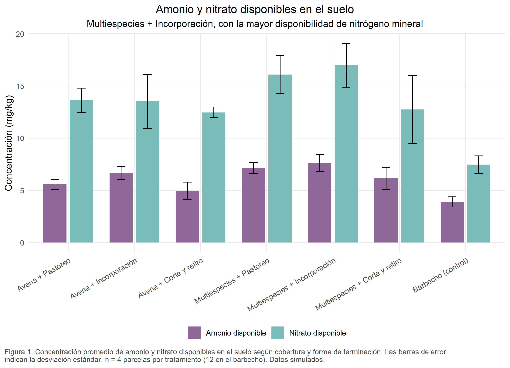
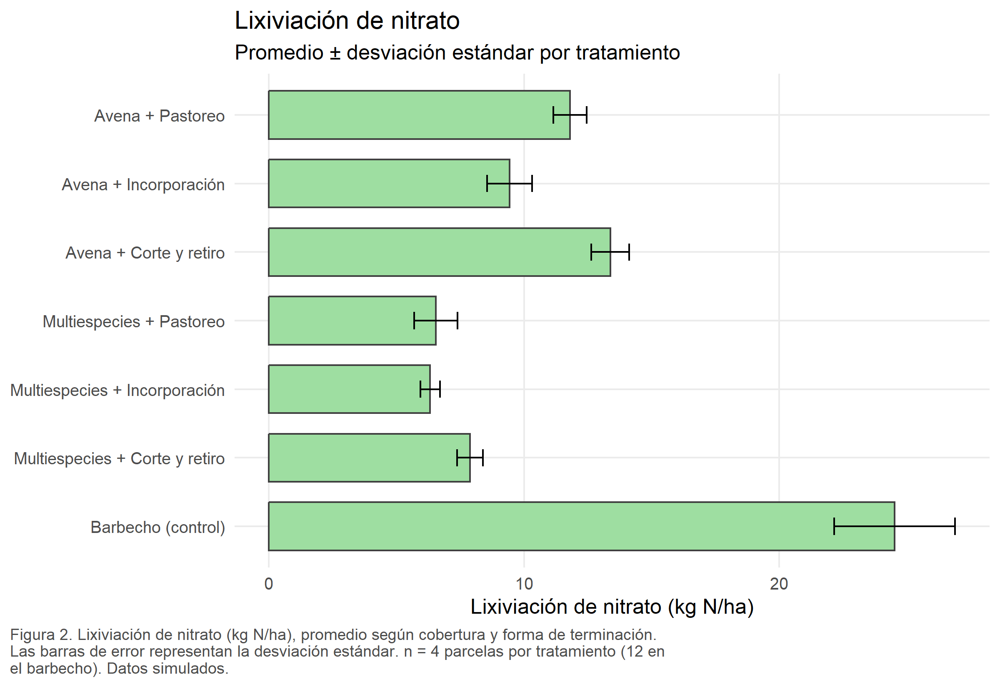
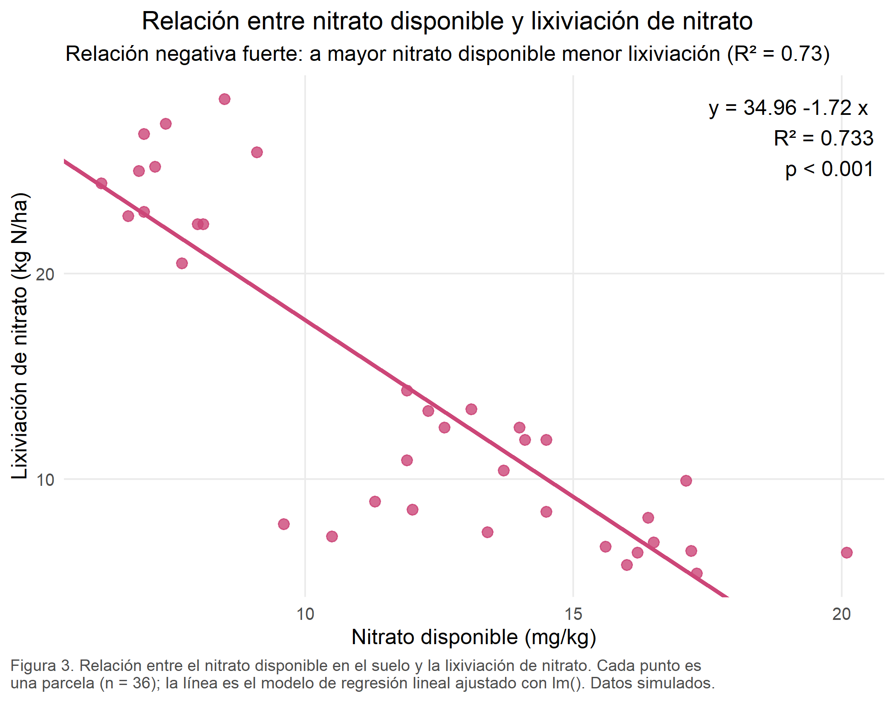
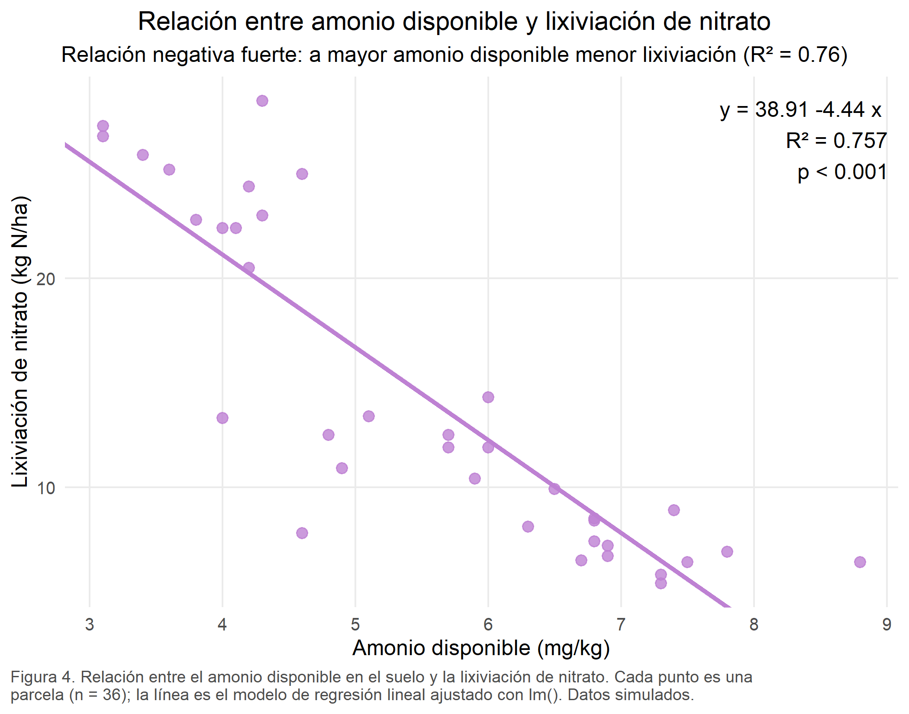

<a id="inicio"></a>

<div align="center">

# Cultivos de cobertura y nitrógeno del suelo: análisis y visualización de datos en R

**Proyecto Final del Curso Visualización y Análisis de Datos**

**Doctorado en Ciencias de la Agricultura y la Naturaleza**

**Autora:** Danurys Lara Acosta
**Fecha de elaboración:** 26 de noviembre de 2026

</div>

---

<a id="indice"></a>

## Índice

1. [Descripción del Proyecto](#descripcion)
2. [Datos](#datos)
3. [Diccionario de Datos](#diccionario)
4. [Validación de Datos](#validacion)
5. [Metodología o Procedimiento](#metodologia)
6. [Resultados](#resultados)
   - [6.1 Amonio y nitrato disponibles en el suelo](#res1)
   - [6.2 Lixiviación de nitrato](#res2)
   - [6.3 Relación de la lixiviación con el nitrato y el amonio disponibles](#res3)
7. [Conclusiones](#conclusiones)
8. [Organización del Repositorio](#organizacion)
9. [Reproducibilidad](#reproducibilidad)
10. [Declaración de uso de Inteligencia Artificial](#ia)
11. [Referencias Bibliográficas](#referencias)

---

<a id="descripcion"></a>

## 1. Descripción del Proyecto

<p align="justify">

Estudios realizados en la zona central de Chile han identificado un alto riesgo de carga de nitrógeno en los cuerpos de agua, asociado al uso de fertilizantes nitrogenados y a la contaminación por nitratos derivada de la actividad agrícola. Por ello, actualmente se buscan estrategias que mejoren la fertilidad del suelo y la disponibilidad de nitrógeno para los cultivos comerciales sin comprometer la calidad del agua.
Este proyecto evalúa el manejo integrado de dos cultivos de cobertura, avena y una mezcla multiespecie, y de tres métodos de terminación: incorporación del cultivo de cobertura por labranza, pastoreo equino de corta duración y corte para forraje fresco; incluye además un barbecho. El experimento se realizó en la Estación Experimental de Pirque de la Fundación AgroUC, Región Metropolitana de Chile.

</p>

<p align="justify">

**Objetivo.**  Determinar el efecto de la combinación de las coberturas vegetales con los diferentes métodos de terminación sobre la disponibilidad de amonio (NH₄⁺) y nitrato (NO₃⁻) en el suelo, y las pérdidas de nitrato por lixiviación.

</p>

<p align="center">
  
</p>

[Volver al índice](#indice)

---

<a id="datos"></a>

## 2. Datos

<p align="justify">

Los datos usados en este proyecto **no son mediciones reales, fueron simulados con Inteligencia Artificial**, Por motivos de confidencialidad y protección de los datos originales de mi investigación doctoral.

</p>

| Aspecto | Detalle |
|---|---|
| Herramienta | ChatGPT (OpenAI) |
| Versión | **[GPT-5]** |
| Fecha de simulación | **[27 de septiembre de 2026]** |
| Unidad de observación | Parcela (36 en total) |
| Archivo original | `datos/01_datos_crudos/datos_crudos.xlsx` |
| Archivo procesado | `datos/02_datos_procesados/datos_procesados.csv` |

**Criterios establecidos para la simulación**

<p align="justify">

- Diseño de 4 bloques con 9 parcelas cada uno (36 parcelas), con las coberturas distribuidas al azar en cada bloque.
- Tratamientos: avena y multiespecies, cada una con pastoreo, incorporación y corte y retiro (4 parcelas por combinación), y barbecho control (12 parcelas, 3 por bloque).
- Variables: amonio disponible (mg/kg), nitrato disponible (mg/kg) y lixiviación de nitrato (kg N/ha).
- Valores del barbecho con más nitrato lixiviado y menos amonio y nitrato en el suelo que los de las coberturas.
- Valores de las multiespecies con menor lixiviación que los de la avena, y menor lixiviación con incorporación y pastoreo que con corte y retiro.
- Valores positivos, con un decimal, sin datos ausentes.

</p>

**Prompt utilizado**:

```text
[Actúa como un experto en búsqueda de datos en la literatura científica.

Contexto: debo realizar un trabajo académico y no quiero utilizar los datos reales de mi proyecto de investigación doctoral, por protección y confidencialidad. Necesito un conjunto de datos simulados, realistas y coherentes con lo publicado.

Tarea:
1. Busca en la literatura científica valores típicos de amonio disponible en el suelo (mg/kg), nitrato disponible en el suelo (mg/kg) y lixiviación de nitrato (kg N/ha) en sistemas con cultivos de cobertura y barbecho. Indica las fuentes consultadas.
2. A partir de esos valores de referencia, completa la tabla adjunta en formato Excel (.xlsx), con una fila por parcela y sin dejar celdas vacías.

Diseño experimental:
- 4 bloques con 9 parcelas cada uno (36 parcelas en total).
- Coberturas: avena, multiespecies (leguminosas, gramíneas y brasicáceas) y barbecho (control), distribuidas al azar dentro de cada bloque.
- Terminaciones de las coberturas: pastoreo, incorporación y corte y retiro. El barbecho no tiene terminación.

Criterios para los valores:
- Amonio y nitrato disponibles: los valores más altos deben corresponder a las multiespecies y los más bajos al barbecho; la avena queda en una posición intermedia.
- Lixiviación de nitrato: los valores más altos deben corresponder al barbecho y los más bajos a las multiespecies; la avena queda en una posición intermedia.]
```

[Volver al índice](#indice)

---

<a id="diccionario"></a>

## 3. Diccionario de Datos

Se genera en el script `04_crear_diccionario_validar_datos.R` y se guarda en `diccionario_validacion/01_diccionario.csv`.

| nombre_variable | etiqueta | descripcion | tipo_dato | unidad | valores_validos | valores_faltantes |
|---|---|---|---|---|---|---|
| bloque | Bloque | Bloque experimental de la parcela | Categórico (factor) | No aplica | 1, 2, 3, 4 | No admite valores faltantes |
| parcela | Parcela | Identificador de la parcela | Texto | No aplica | Código de tres dígitos, único | No admite valores faltantes |
| cobertura | Cobertura | Tipo de cobertura; Barbecho es el control | Categórico (factor) | No aplica | Avena; Multiespecies; Barbecho | No admite valores faltantes |
| terminacion | Terminación | Forma de terminación; el barbecho no tiene terminación | Categórico (factor) | No aplica | Pastoreo; Incorporación; Corte y retiro; Sin terminación | No admite valores faltantes |
| amonio_mg_kg | Amonio disponible | Amonio (NH₄⁺) disponible en el suelo, por parcela | Numérico | mg/kg | > 0 y ≤ 20 | Admite NA (se codifica como NA) |
| nitrato_mg_kg | Nitrato disponible | Nitrato (NO₃⁻) disponible en el suelo, por parcela | Numérico | mg/kg | > 0 y ≤ 30 | Admite NA (se codifica como NA) |
| lixiviacion_nitrato_kgN_ha | Lixiviación de nitrato | Pérdida de nitrato (NO₃⁻) por lixiviación, por parcela | Numérico | kg N/ha | > 0 y ≤ 50 | Admite NA (se codifica como NA) |

**Resumen del diccionario**

<p align="justify">

- **Estructura:** 7 variables y 36 observaciones (una por parcela). Cuatro son de identificación y diseño (`bloque`, `parcela`, `cobertura`, `terminacion`) y tres son de respuesta (`amonio_mg_kg`, `nitrato_mg_kg`, `lixiviacion_nitrato_kgN_ha`).
- **Variables categóricas:** `bloque` (4 niveles), `cobertura` (3 niveles) y `terminacion` (4 niveles, incluida "Sin terminación", exclusiva del barbecho). `parcela` es un código único de tres dígitos tratado como texto, porque no se opera aritméticamente con él.
- **Variables numéricas:** el amonio y el nitrato se expresan en mg/kg de suelo y la lixiviación en kg N/ha.
- **Rangos de aceptación:** amonio mayor que 0 y hasta 20 mg/kg, nitrato mayor que 0 y hasta 30 mg/kg, y lixiviación mayor que 0 y hasta 50 kg N/ha. Los valores observados quedan dentro de esos límites: amonio de 3,1 a 8,8; nitrato de 6,2 a 20,1; lixiviación de 5,4 a 28,5.
- **Valores faltantes:** las variables de diseño no admiten NA. Las tres variables de respuesta sí los admiten, codificados como `NA`, y se informan en la validación sin invalidar el conjunto. En los datos procesados no hay ningún NA.
- **Archivo:** se guarda como CSV en UTF-8 con BOM para que Excel muestre bien las tildes y los subíndices.

Los rangos de aceptación fueron establecidos a partir de los valores reportados para estas variables en la literatura.

</p>


[Volver al índice](#indice)

---

<a id="validacion"></a>

## 4. Validación de Datos

Los controles se aplican en el mismo script `04_crear_diccionario_validar_datos.R`, a partir de las reglas del diccionario, y se guardan en `diccionario_validacion/02_validacion_datos.csv`. Los controles "Informativo" solo informan sin invalidar los datos.

| variable | control | criterio | n_revisados | n_casos | resultado | detalle |
|---|---|---|---|---|---|---|
| bloque | Valores faltantes | No admite NA | 36 | 0 | Cumple | |
| bloque | Categorías válidas | 1; 2; 3; 4 | 36 | 0 | Cumple | |
| cobertura | Valores faltantes | No admite NA | 36 | 0 | Cumple | |
| cobertura | Categorías válidas | Avena; Multiespecies; Barbecho | 36 | 0 | Cumple | |
| terminacion | Valores faltantes | No admite NA | 36 | 0 | Cumple | |
| terminacion | Categorías válidas | Pastoreo; Incorporación; Corte y retiro; Sin terminación | 36 | 0 | Cumple | |
| parcela | Valores faltantes | No admite NA | 36 | 0 | Cumple | |
| parcela | Valores únicos | Sin duplicados | 36 | 0 | Cumple | |
| amonio_mg_kg | Valores faltantes | Admite NA (solo se informa) | 36 | 0 | Informativo | |
| amonio_mg_kg | Rango válido | > 0 y ≤ 20 | 36 | 0 | Cumple | |
| nitrato_mg_kg | Valores faltantes | Admite NA (solo se informa) | 36 | 0 | Informativo | |
| nitrato_mg_kg | Rango válido | > 0 y ≤ 30 | 36 | 0 | Cumple | |
| lixiviacion_nitrato_kgN_ha | Valores faltantes | Admite NA (solo se informa) | 36 | 0 | Informativo | |
| lixiviacion_nitrato_kgN_ha | Rango válido | > 0 y ≤ 50 | 36 | 0 | Cumple | |
| (todas) | Datos ausentes | Filas con algún NA (solo se informa) | 36 | 0 | Informativo | |
| cobertura / terminacion | Coherencia | Sin terminación solo en Barbecho | 36 | 0 | Cumple | |

**Resumen:** de los 16 controles, 12 se cumplen y 4 son informativos (sin datos ausentes). No se detectó ningún caso fuera de las categorías o de los rangos definidos, ni parcelas duplicadas, por lo que los datos quedan listos para el análisis.

[Volver al índice](#indice)

---

<a id="metodologia"></a>

## 5. Metodología 

<p align="justify">

El análisis se realizó en R con RStudio. Cada paso es un script numerado dentro de `scripts/`, y todas las rutas se construyen con `here` para que el proyecto funcione en cualquier computadora.

</p>

**Paquetes utilizados**

| Paquete | Uso en el proyecto |
|---|---|
| `here` | Rutas relativas a la raíz del proyecto |
| `readxl` | Lectura del Excel de datos crudos |
| `readr` | Lectura y escritura de archivos CSV |
| `dplyr` | Transformación, agrupación y resumen de datos |
| `tidyr` | Anidado de datos (`nest`) y desanidado (`unnest`) |
| `purrr` | Aplicación de funciones por grupo (`map`) |
| `ggplot2` | Gráficos |
| `viridisLite` | Paletas viridis y plasma, aptas para daltonismo |
| `renv` | Entorno reproducible y registro de versiones |

**Pasos**

<p align="justify">

1. **Crear el repositorio y la estructura.** Se creó el repositorio en GitHub con las carpetas `datos/` (con `01_datos_crudos/` y `02_datos_procesados/`), `scripts/`, `diccionario_validacion/`, `tablas/` y `figuras/`, y se clonó en RStudio como proyecto (`.Rproj`).
2. **`01_cargar_librerias.R`.** Carga los paquetes del proyecto en un solo lugar.
3. **`02_cargar_transformar_datos.R`.** Lee `datos_crudos.xlsx`, traduce y estandariza los nombres y las categorías al español, fija los tipos de variable y guarda `datos_procesados.csv`. El archivo crudo no se modifica en la carpeta `02_datos_procesados/`dentro de la carpeta `datos/`.
4. **`03_registrar_paquetes_renv.R`.** Inicializa `renv`, comprueba el estado y registra las versiones de los paquetes en `renv.lock`.
5. **`04_diccionario_validacion.R`.** Crea el diccionario y la validación a partir de reglas únicas (categorías y rangos), y guarda `01_diccionario.csv` y `02_validacion_datos.csv`en la carpeta `diccionario_validacion/`.
6. **`05_promedio_desviacion.R`.** Agrupa con `group_by()`, anida los datos con `nest()`, calcula con `map()` el promedio y la desviación estándar de cada variable por tratamiento, y guarda las tablas en la carpeta `tablas/`.
7. **`06_regresion_lineal.R`.** Ajusta con `lm()` la regresión lineal de la lixiviación frente al nitrato y frente al amonio, y guarda los coeficientes y el resumen en la carpeta `tablas/`.
8. **`07_figuras.R`.** Genera con `ggplot2` las cuatro figuras y las guarda como PNG en la carpeta `figuras/`. Se usan paletas viridis y plasma, que se distinguen bien con daltonismo, y barras de error de ±1 desviación estándar.
9. **Registro final.** Se ejecuta `renv::snapshot()` al terminar, para guardar los paquetes usados, y se hace commit y push a GitHub desde la pestaña Git de RStudio, con mensajes que describen cada cambio.

</p>

[Volver al índice](#indice)

---

<a id="resultados"></a>

## 6. Resultados

<p align="justify">

Las medias y desviaciones estándar corresponden a 4 parcelas por tratamiento (12 en el barbecho). Los datos son simulados, así que los resultados ilustran el análisis y no deben interpretarse como evidencia experimental.

</p>

<a id="res1"></a>

### 6.1 Amonio y nitrato disponibles en el suelo según cobertura y terminación

<p align="center">
  
</p>

<p align="justify">

Los dos nutrientes, amomio y nitrato, siguieron el mismo comportante entre tratamientos. El barbecho presentó los valores más bajos (amonio 3,89 mg/kg ± 0,49 mg/kg y nitrato 7,48 ± 0,83 mg/kg). Las cobertura multiespecie mostró mayor concentración de amonio y nitrato disponible en el suelo que la cobertura avena (promedio de amonio 6,98 mg/kg frente a 5,73 mg/kg y de nitrato 15,28 mg/kg frente a 13,21 mg/kg). Los mayores valores de concentración se obtuvieron con la cobertura multiespecie con incorporación (amonio 7,62 mg/kg y nitrato 16,98 mg/kg) y cobertura multiespecie con pastoreo (amonio 6,36 mg/kg y nitrato 14,86 mg/kg).

</p>


<a id="res2"></a>

### 6.2 Lixiviación de nitrato por tratamiento

<p align="center">
  
</p>

<p align="justify">

Se observó mayor pérdida de nitrato  por lixiviación en las parcelas con barbecho que en las coberturas, con 24,52 ± 2,37 kg N/ha.El tramiento multiespecie más incorporación (6,32 kg N/ha, 74 % menos) y el pastoreo (6,55 kg N/ha, 73 % menos) mostaron los menores valores de pérdida de nitrato por lixiviación, seguido por el corte y retiro (7,88 kg N/ha, 68 % menos).

</p>

<a id="res3"></a>

### 6.3 Relación de la lixiviación con el nitrato y el amonio disponibles

<table align="center">
  <tr>
    <td align="center"></td>
    <td align="center"></td>
  </tr>
  <tr>
    <td align="center"><strong>Figura 3.</strong> Nitrato disponible y lixiviación</td>
    <td align="center"><strong>Figura 4.</strong> Amonio disponible y lixiviación</td>
  </tr>
</table>

**Nitrato:** La regresión lineal es lixiviación = 34,96 − 1,72 × nitrato. La pendiente es negativa: cada mg/kg más de nitrato disponible se asocia con 1,72 kg N/ha menos de lixiviación (EE = 0,18). El modelo explica el 73,3 % de la variación (R² = 0,733; R² ajustado = 0,726; n = 36; p = 2,7 × 10⁻¹¹).

**Amonio:** La regresión lineal es lixiviación = 38,91 − 4,44 × amonio. Cada mg/kg más de amonio disponible se asocia con 4,44 kg N/ha menos de lixiviación (EE = 0,43). El modelo explica el 75,7 % de la variación (R² = 0,757; R² ajustado = 0,750; n = 36; p = 5,4 × 10⁻¹²).

<p align="justify">

Ambas relaciones son inversas. Esto es coherente con que las parcelas con cobertura retienen más nitrógeno mineral en el suelo y pierden menos por lixiviación. En cuanto al barbecho, las parcelas presentaron bajas concentraciones nitrógeno disponible en suelo y altos valores de lixiviación de nitrato.

</p>

[Volver al índice](#indice)

---

<a id="conclusiones"></a>

## 7. Conclusiones

<p align="justify">

- Con los datos simulados, los cultivos de cobertura reducen la lixiviación de nitrato frente al barbecho, y retienen más amonio y nitrato en el suelo. 
- La mezcla de multiespecies (leguminosas, gramíneas y brasicáceas) controla mejor la lixiviación que la avena sola, y además aporta más nitrógeno mineral disponible en el suelo. 
- La forma de terminación del cultivo de cobertura influye directamente en la disponinibilidad de nitrógeno y la lixiviación de nitrato. La incorporación y el pastoreo devuelven el nitrógeno al sistema y mantienen niveles menores de lixiviación que el corte y retiro. 
- La lixiviación se relaciona de forma inversa con el amonio y el nitrato disponibles en el suelo. 
- Como los datos son simulados y no se hicieron pruebas inferenciales entre tratamientos, estas conclusiones son una demostración del flujo de análisis. Para sustentar un efecto real se necesitan datos medidos en campo y un análisis estadístico acorde con el diseño en bloques.

</p>

[Volver al índice](#indice)

---

<a id="organizacion"></a>

## 8. Organización del Repositorio

```text
cobertura-terminacion-nitrogeno/
├── datos/
│   ├── 01_datos_crudos/
│   │   └── datos_crudos.xlsx                       # Datos simulados originales, sin modificar
│   └── 02_datos_procesados/
│       └── datos_procesados.csv                    # Datos limpios, en español y con tipos definidos
├── diccionario_validacion/
│   ├── 01_diccionario.csv                          # Descripción de las variables
│   └── 02_validacion_datos.csv                     # Resultados de los controles de calidad
├── figuras/
│   ├── 00_diseno_experimental.png                  # Esquema del diseño en bloques
│   ├── 01_amonio_nitrato.png                       # Amonio y nitrato disponibles por tratamiento
│   ├── 02_lixiviacion_nitrato.png                  # Lixiviación de nitrato por tratamiento
│   ├── 03_regresion_nitrato_lixiviacion.png        # Regresión nitrato disponible - lixiviación
│   └── 04_regresion_amonio_lixiviacion.png         # Regresión amonio disponible - lixiviación
├── renv/                                           # Biblioteca y archivos de renv
├── scripts/
│   ├── 01_cargar_librerias.R                       # Carga de paquetes
│   ├── 02_cargar_transformar_datos.R               # Lectura, transformación y guardado de datos
│   ├── 03_registrar_paquetes_renv.R                # Registro de paquetes con renv
│   ├── 04_crear_diccionario_validar_datos.R        # Diccionario y validación
│   ├── 05_analisis_promedio_desviacion.R           # Promedios y desviaciones estándar
│   ├── 06_relacion_nitrato_lixiviacion.R           # Regresiones lineales
│   └── 07_graficos.R                               # Figuras con ggplot2
├── tablas/
│   ├── 01_datos_anidados.csv                       # Datos agrupados y anidados por tratamiento
│   ├── 02_promedio_desviacion_estandar.csv         # Promedio y desviación estándar por tratamiento
│   ├── 03_regresion_nitrato_lixiviacion.csv        # Regresión lixiviación ~ nitrato
│   └── 04_regresion_amonio_lixiviacion.csv         # Regresión lixiviación ~ amonio
├── .Rprofile                                       # Activa renv al abrir el proyecto
├── .gitignore                                      # Archivos que Git no sigue
├── README.md                                       # Este documento
├── cobertura-terminacion-nitrogeno.Rproj           # Archivo de proyecto de RStudio
└── renv.lock                                       # Versiones exactas de los paquetes
```

| Carpeta o archivo | Contenido |
|---|---|
| `datos/01_datos_crudos` | Excel original con los datos simulados; no se edita |
| `datos/02_datos_procesados` | CSV generado por el script 02 |
| `diccionario_validacion` | Diccionario de datos y resultado de la validación (script 04) |
| `figuras` | Esquema del diseño experimental y las cuatro figuras del análisis (script 07) |
| `renv` | Biblioteca de paquetes del proyecto |
| `scripts` | Siete scripts numerados en el orden de ejecución |
| `tablas` | Datos anidados, promedios y desviaciones estándar, y resultados de las dos regresiones (scripts 05 y 06) |
| `.Rprofile`, `renv.lock` | Entorno reproducible con `renv` |
| `.gitignore` | Archivos excluidos del control de versiones |
| `.Rproj` | Proyecto de RStudio, que fija la carpeta raíz de trabajo |

[Volver al índice](#indice)

---

<a id="reproducibilidad"></a>

## 9. Reproducibilidad

El proyecto usa **`renv`** para que cualquier persona pueda ejecutar el análisis con las mismas versiones de los paquetes que se usaron en este proyecto.

**Función de `renv`**

- Crea una biblioteca de paquetes propia del proyecto, aislada de las demás instalaciones de R.
- Registra en `renv.lock` la versión exacta y la fuente de cada paquete.
- Permite restaurar ese entorno en otro equipo o en el futuro, aunque los paquetes hayan cambiado.

**Uso en este proyecto**

1. En el script `03_registrar_paquetes_renv.R` se inicializó el entorno con `renv::init()`, y se ejecuta `renv::status()` para comprobar que no hay problemas.
2. Cada vez que se agrega un paquete (por ejemplo `purrr`), se ejecuta `renv::snapshot()` para actualizar `renv.lock`, y el archivo se sube a GitHub con un commit.

**Cómo reproducir el análisis**

```r
# 1. Clona el repositorio y abre el archivo .Rproj en RStudio
# 2. Restaura los paquetes con las versiones registradas
install.packages("renv")   # solo si renv no está instalado
renv::restore()

# 3. Ejecuta los scripts en orden (02 a 07)
source("scripts/02_cargar_transformar_datos.R")
source("scripts/04_crear_diccionario_validar_datos.R")
source("scripts/05_analisis_promedio_desviacion.R")
source("scripts/06_relacion_nitrato_lixiviacion.R")
source("scripts/07_graficos.R")
```

Versión de R usada: **[4.6.1]**

[Volver al índice](#indice)

---

<a id="ia"></a>

## 10. Declaración de uso de Inteligencia Artificial

- **ChatGPT** (OpenAI), versión **[GPT-5]**: se utilizó para **simular los datos** del proyecto (véase la sección [Datos](#datos)).
- **Claude** (Anthropic), versión **[Claude Sonnet 5.5]**: se utilizó para **verificar y corregir el código** en R, y para orientar la creación del repositorio, los scripts, las figuras y la redacción del README.

Los resultados, las interpretaciones y las decisiones del proyecto fueron revisados por la autora.

[Volver al índice](#indice)

---

<a id="referencias"></a>

## 11. Referencias Bibliográficas

- Garnier, S., Ross, N., Rudis, B., Sciaini, M., Camargo, A. P., y Scherer, C. (2024). *viridis: Colorblind-Friendly Color Maps for R* (versión 0.6.5) [Paquete de R]. CRAN. https://doi.org/10.32614/CRAN.package.viridis
- Müller, K. *here: A Simpler Way to Find Your Files* [Paquete de R]. CRAN. https://CRAN.R-project.org/package=here
- Nuñez, J. R., Anderton, C. R., y Renslow, R. S. (2018). Optimizing colormaps with consideration for color vision deficiency to enable accurate interpretation of scientific data. *PLOS ONE, 13*(7), e0199239. https://doi.org/10.1371/journal.pone.0199239
- R Core Team. *R: A language and environment for statistical computing*. R Foundation for Statistical Computing, Viena, Austria. https://www.R-project.org/
- Ushey, K., y Wickham, H. *renv: Project Environments* [Paquete de R]. CRAN. https://doi.org/10.32614/CRAN.package.renv
- Wickham, H. (2016). *ggplot2: Elegant Graphics for Data Analysis*. Springer-Verlag. https://ggplot2.tidyverse.org
- Wickham, H., Averick, M., Bryan, J., Chang, W., McGowan, L. D., François, R., et al. (2019). Welcome to the tidyverse. *Journal of Open Source Software, 4*(43), 1686. https://doi.org/10.21105/joss.01686

[Volver al índice](#indice)
